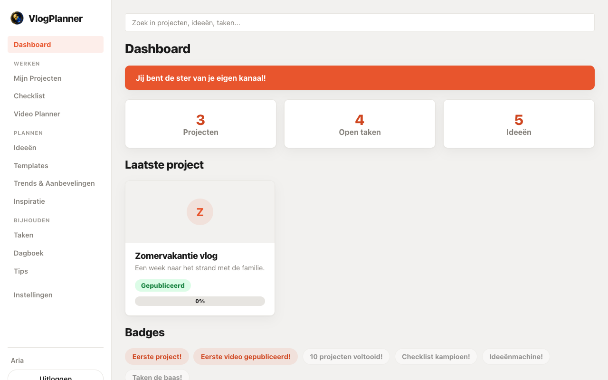
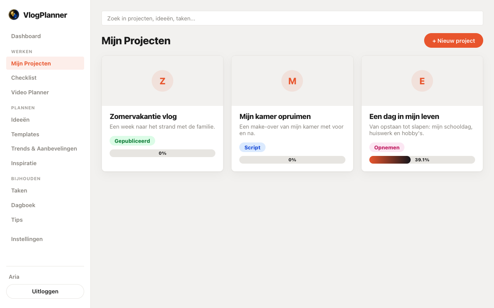
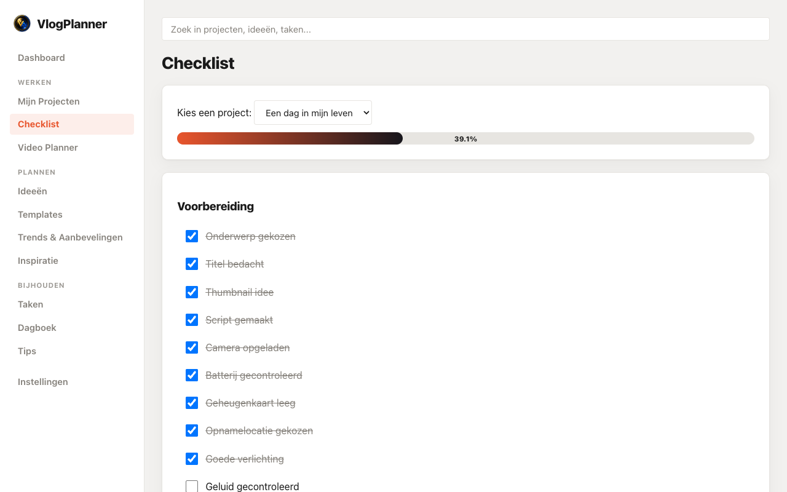
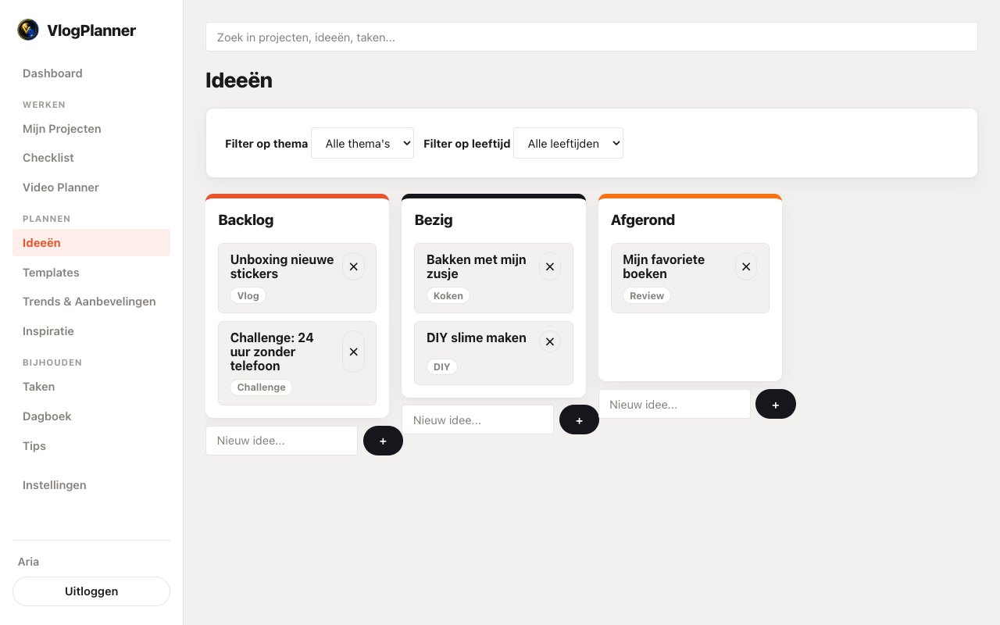
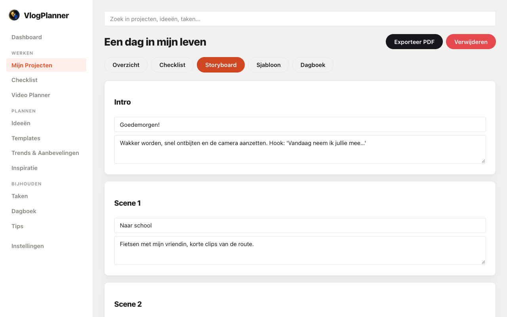
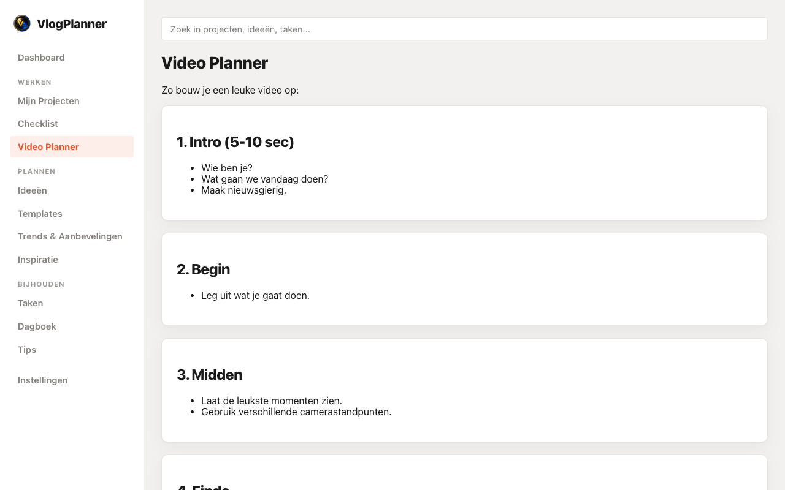
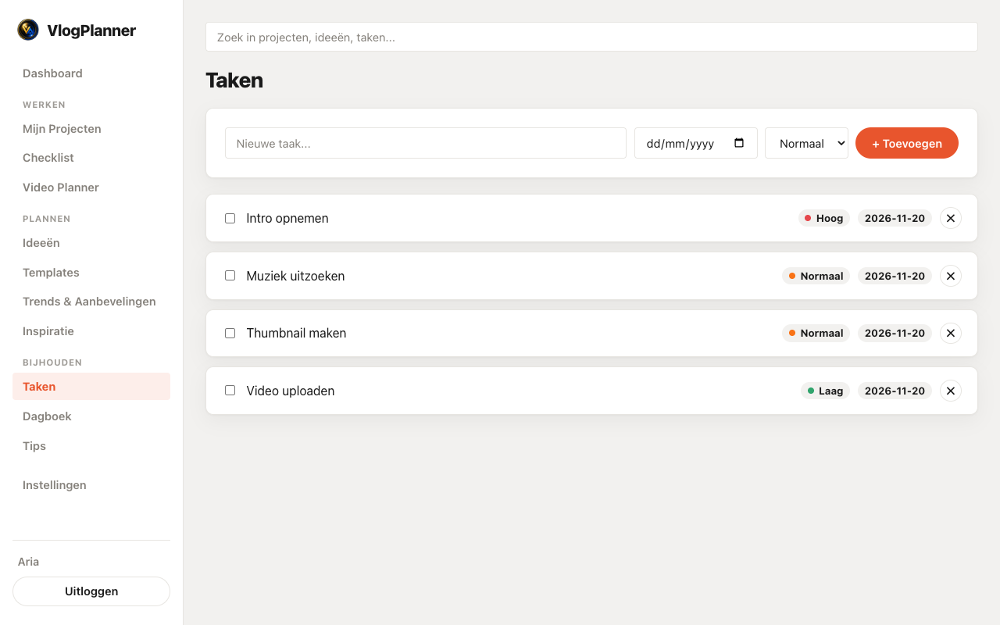
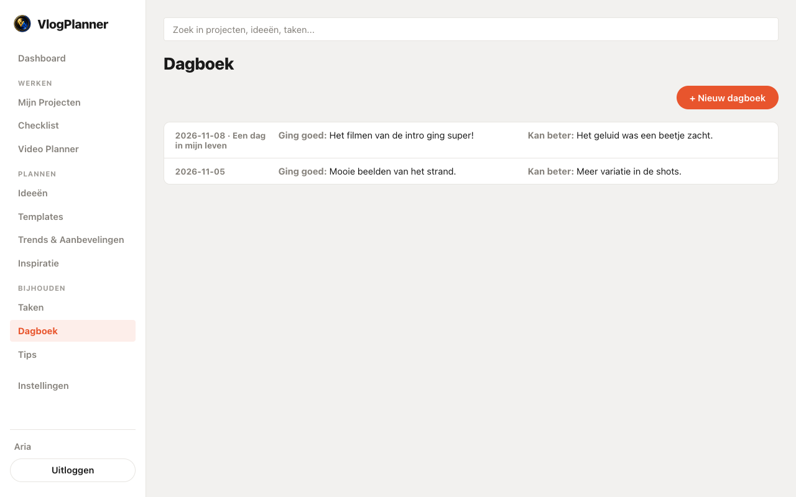

<p align="center">
  
</p>

# VlogPlanner

Een vrolijke, eenvoudige webapp die jonge content creators stap voor stap helpt bij het bedenken, voorbereiden, opnemen en publiceren van YouTube-video's en vlogs.

## Screenshots

| Dashboard | Mijn Projecten | Checklist |
| --- | --- | --- |
|  |  |  |

| Ideeën (Kanban) | Storyboard | Video Planner |
| --- | --- | --- |
|  |  |  |

| Taken | Dagboek |
| --- | --- |
|  |  |

## Installatie (Docker)

Vereisten: [Docker](https://www.docker.com/) en Docker Compose.

Frontend en backend draaien samen in **één container** (FastAPI serveert zowel de API als de gebouwde React-app) — handig voor lokaal gebruik op je eigen LAN, geen aparte nginx-container of poort-gedoe nodig.

De Docker-image wordt kant-en-klaar gebouwd door GitHub Actions (zie `.github/workflows/docker-build.yml`) en gepubliceerd op GitHub Container Registry. Er hoeft dus **niets lokaal gecompileerd te worden** — `docker compose pull` haalt gewoon de laatste kant-en-klare image op.

> **Als de eerste Actions-run faalt met een 403/permission-fout bij het pushen:** ga naar de repo-instellingen → **Actions → General → Workflow permissions** en zet die op **Read and write permissions**. Nieuwe repositories staan soms standaard op alleen-lezen, waardoor de workflow geen packages mag publiceren.

```bash
git clone https://github.com/jayvenco/vlogplanner.git
cd vlogplanner
docker compose pull
docker compose up -d
```

Open daarna **http://localhost:7766** in de browser. Klaar!

> **Eenmalige setup na de allereerste push:** GitHub Actions bouwt de image en zet 'm in GitHub Container Registry, maar een nieuwe package staat daar standaard op **Private** — ook als de repo zelf privé is, kun je de package apart op **Public** zetten zodat `docker compose pull` overal werkt zonder in te loggen. Ga naar je GitHub-profiel → **Packages**, open `vlogplanner`, **Package settings → Change visibility → Public**. Dit hoeft je maar één keer te doen; elke volgende push naar `main` bouwt gewoon een nieuwe versie van dezelfde (publieke) package.

De database (SQLite) en geüploade thumbnails worden automatisch aangemaakt in `./data` en `./uploads` bij de eerste start — geen handmatige configuratie nodig.

### Configuratie (optioneel)

Kopieer `.env.example` naar `.env` om de JWT-secret, tokenvervaltijd of de host-poort aan te passen:

```bash
cp .env.example .env
```

Zonder `.env`-bestand werkt de app ook prima met veilige standaardwaarden voor lokaal gebruik.

**`ENCRYPTION_KEY` (optioneel, aanbevolen):** aparte sleutel waarmee opgeslagen API-sleutels (AI-assistent, YouTube) versleuteld worden. Zonder deze variabele wordt daarvoor `JWT_SECRET_KEY` hergebruikt, zoals voorheen. Zet je 'm later alsnog in een bestaande installatie, dan worden al opgeslagen API-sleutels onleesbaar — vul ze dan opnieuw in via Instellingen. Eenmaal gezet: nooit meer wijzigen.

### Updaten

```bash
cd vlogplanner
git pull
docker compose pull
docker compose up -d
```

### Installeren op Unraid

**Aanbevolen: één commando.** Draai dit in de Unraid-terminal. De container verschijnt daarna in de **Docker-tab** met icoon en WebUI-link, en is te beheren met **Edit**, **Check for Updates** en **Apply Update**:

```bash
curl -fsSL https://raw.githubusercontent.com/jayvenco/vlogplanner/main/scripts/install-unraid.sh | bash
```

Het script (`scripts/install-unraid.sh`) maakt de mappen aan onder `/mnt/user/appdata/vlogplanner/{data,uploads,backups}`, genereert eenmalig de geheime sleutels (opgeslagen in `/mnt/user/appdata/vlogplanner/secret_key`, rechten 600), haalt de image op, start de container met de juiste Unraid-labels en bewaart het template als `my-vlogplanner.xml`. Daarna wacht het op de Docker-healthcheck en toont de URL, standaard `http://<unraid-ip>:7766`.

- **Opnieuw draaien is veilig.** Bestaande data en sleutels blijven staan; een bestaande installatie (inclusief een `.env` van `install-docker-run.sh`) wordt overgenomen, dus je logins en opgeslagen API-sleutels blijven werken.
- **Aanpassen** met omgevingsvariabelen achter de pipe, bijvoorbeeld `curl -fsSL ... | PORT=8080 bash`. Beschikbaar: `PORT`, `APPDATA`, `IMAGE_TAG`.
- **Privé GHCR-package?** Gebruik `curl -fsSL ... | GHCR_USER=<naam> GHCR_TOKEN=<token> bash`.
- **Updaten:** klik in de Docker-tab op **Check for Updates** en daarna **Apply Update** (of draai het script gewoon opnieuw).

**Via een template (alternatief).** Kopieer [`unraid/vlogplanner.xml`](unraid/vlogplanner.xml) naar `/boot/config/plugins/dockerMan/templates-user/` (of zet de raw-URL bij *Template repositories* onder Docker-instellingen), kies in de Docker-tab **Add Container → vlogplanner**, vul minstens `JWT_SECRET_KEY` in (een lange willekeurige tekst) en klik op Apply. Het script hierboven doet dit allemaal voor je.

**Alternatief met Docker Compose** (Unraid 6.12+ heeft `docker compose` ingebouwd), zonder Docker-tab-beheer:

```bash
cd /mnt/user/appdata
git clone https://github.com/jayvenco/vlogplanner.git
cd vlogplanner
docker compose pull
docker compose up -d
```

Open daarna `http://<jouw-unraid-ip>:7766`. Data blijft bewaard in `./data`, `./uploads` en `./backups` binnen die map. Updaten: `cd /mnt/user/appdata/vlogplanner && git pull && docker compose pull && docker compose up -d`. Poort 7766 al in gebruik? Zet `FRONTEND_PORT=<andere-poort>` in `.env` (zie "Configuratie"). Werkt `docker compose` niet (Unraid ouder dan 6.12)? Installeer dan de **Compose Manager**-plugin.

**Liever plain `docker run` zonder Docker-tab-integratie?** `install-docker-run.sh` (eenmalig) en `update-docker-run.sh` blijven beschikbaar en raken je data nooit aan.

**Zelf bouwen in plaats van de kant-en-klare image pullen?** Vervang in `docker-compose.yml` de `image:`-regel tijdelijk door `build: .` en draai `docker compose up --build -d`. Kom je dan de foutmelding `compose build requires buildx 0.17.0 or later` tegen (bekend op oudere Unraid-installaties)? Zet dan `DOCKER_BUILDKIT=0` vóór het commando, of permanent in je `.env`-bestand.

## Ontwikkelmodus (zonder Docker)

**Backend** (vereist Python 3.12; werkt ook op 3.9+):

```bash
cd backend
python3 -m venv venv && source venv/bin/activate
pip install -r requirements.txt
uvicorn main:app --reload --port 8000
```

**Frontend** (vereist Node 20+):

```bash
cd frontend
npm install
npm run dev
```

Open **http://localhost:5173**. Vite proxyt `/api` en `/uploads` automatisch naar de backend op poort 8000, dus er is geen CORS-configuratie nodig.

## Productie

`docker compose pull && docker compose up -d` haalt de kant-en-klare image op (gebouwd door GitHub Actions) en start één container op de achtergrond: FastAPI serveert zowel de API (`/api/*`, `/uploads/*`) als de gebouwde React-app, op poort 7766 (te wijzigen via `FRONTEND_PORT`).

Data blijft bewaard in de bind-mounts `./data` (database), `./uploads` (thumbnails) en `./backups` (automatische back-ups), ook na `docker compose down`. Gebruik `docker compose down -v` alleen als je bewust alles wilt wissen (let op: dit verwijdert geen bind-mounts, enkel eventuele named volumes).

### Automatische back-ups

Elke 1e van de maand (03:00 uur) maakt de backend automatisch een zip van de database en alle geüploade thumbnails in `./backups/`. De laatste 12 back-ups worden bewaard; oudere back-ups worden automatisch verwijderd. Bij Instellingen staat ook een "Back-up nu maken"-knop om op elk moment zelf een back-up te maken, buiten dit schema om.

### YouTube koppelen (optioneel)

Om projecten te kunnen koppelen aan echte YouTube-video's (zie "YouTube" hieronder) heb je je eigen gratis Google OAuth-credentials nodig — de app kan deze niet voor je aanmaken. Eenmalig instellen:

1. Ga naar de [Google Cloud Console](https://console.cloud.google.com/) en maak een nieuw project (of gebruik een bestaand project).
2. Ga naar **APIs & Services → Library**, zoek **YouTube Data API v3** en klik op **Enable**.
3. Ga naar **APIs & Services → OAuth consent screen**, kies **External**, vul de verplichte velden in (appnaam, e-mail) en voeg jezelf toe als **Test user** (zolang de app niet gepubliceerd is bij Google, kunnen alleen test users inloggen).
4. Ga naar **APIs & Services → Credentials → Create Credentials → OAuth client ID**, kies type **Web application**.
5. Voeg bij **Authorized redirect URIs** exact toe:
   - Lokaal ontwikkelen: `http://localhost:5173/api/youtube/callback`
   - Productie (Docker): `http://<jouw-host>:7766/api/youtube/callback` (of je eigen domein/poort)
6. Kopieer de **Client ID** en **Client secret** naar je `.env`-bestand:

```bash
YOUTUBE_CLIENT_ID=jouw-client-id.apps.googleusercontent.com
YOUTUBE_CLIENT_SECRET=jouw-client-secret
YOUTUBE_REDIRECT_URI=http://localhost:5173/api/youtube/callback
```

7. (Her)start de app. Bij **Instellingen** verschijnt nu een werkende "Verbind met YouTube"-knop. Zonder deze variabelen blijft de rest van de app gewoon werken — alleen die knop geeft dan een nette foutmelding.

### YouTube trends (optioneel, apart van hierboven)

De **Trends & Aanbevelingen**-pagina gebruikt een heel andere, veel eenvoudigere credential dan de OAuth-koppeling hierboven: een kale **Data API v3-sleutel**, geen OAuth-consent nodig.

1. In dezelfde Google Cloud Console: **APIs & Services → Credentials → Create Credentials → API key**.
2. Zet die sleutel in `.env` als `YOUTUBE_API_KEY=...`.
3. Zonder deze sleutel toont de Trends-tab gewoon een nette "niet geconfigureerd"-melding; de rest van de app blijft werken.

Trend-data wordt maximaal elke 6 uur ververst (gecached in de database) om binnen de gratis API-quota te blijven — geen live call per paginabezoek.

### Wachtwoord (optioneel)

Een profiel heeft standaard **geen wachtwoord**: inloggen kan met alleen de naam. Wil je een profiel afschermen, ga dan naar **Instellingen → Account → Wachtwoord** om er een in te stellen, te wijzigen of weer te verwijderen (het huidige wachtwoord is daarvoor nodig). Heeft een profiel een wachtwoord, dan vraagt het inlogscherm er automatisch om.

**Wachtwoord vergeten?** Een beheerder kan het resetten vanaf de server (op Unraid in de terminal):

```bash
# wachtwoord verwijderen, daarna kan het profiel weer met alleen de naam inloggen
docker exec vlogplanner python reset_password.py <gebruikersnaam>

# of direct een nieuw wachtwoord instellen (vraagt er interactief om)
docker exec -it vlogplanner python reset_password.py <gebruikersnaam> --set
```

## Functionaliteit

- 🏠 **Dashboard** — overzicht van projecten, taken, ideeën, laatste project, motiverende quote en behaalde badges
- 🎬 **Mijn Projecten** — video-projecten met titel, beschrijving, thumbnail en status (Idee → Script → Opnemen → Bewerken → Klaar → Gepubliceerd)
- ✅ **Checklist** — automatische checklist per project (voorbereiding / tijdens filmen / na filmen), met eigen items toevoegen
- 🎞️ **Storyboard** — eenvoudig scène-voor-scène storyboard per project (Intro, Scene 1-3, Einde)
- 🧭 **Sjabloon** — leidraad per project (thema, bronnen, afbeeldingen-ideeën, inspiratie-URLs, opbouw intro/midden/einde) plus een veld om de AI-assistent om tips te vragen
- 📝 **Video Planner** — uitleg over hoe je een leuke video opbouwt
- 📖 **Tips** — tips over filmen, geluid, presenteren en bewerken
- 💡 **Ideeën-backlog** — Kanban-bord (Backlog / Bezig / Afgerond) met drag & drop; elk idee heeft een korte beschrijving, thema/tag, doelgroep-leeftijd, geschatte productiedatum, notities en een gekoppelde content-template. Filter op thema en leeftijd.
- 📚 **Templates** — bibliotheek met 5 herbruikbare vlog-formats (Dag-in-het-leven, Tutorial, Q&A, Review, Storytime), elk met script-structuur (hook/intro/body/cta/outro), aanbevolen videolengte, thumbnail-tips, titel-formules en een checklist per productiefase
- 🔮 **Trends & Aanbevelingen** — trending YouTube-video's per categorie (gecached, max. elke 6u ververst) met zoekwoord-extractie en view-velocity; plus een aanbevelingsmodule die op basis van doelgroep-leeftijd + thema een content-suggestie, passende template en toon/lengte-advies geeft met onderbouwing. Dit is een eenvoudige regel-gebaseerde matching, geen AI/ML-model.
- 📌 **Inspiratie** — losse inspiratie bewaren (links, screenshot-notities, quotes) met tags, los van de Ideeën-backlog
- 📋 **Taken** — todo-lijst met deadline en prioriteit
- 📔 **Dagboek** — bijhouden wat goed ging en wat beter kan, per project of algemeen
- 🏅 **Badges** — beloningen voor mijlpalen zoals "Eerste project!" en "Checklist kampioen!"
- 🎨 **5 thema's** — Licht, Donker, Rainbow, Cyberpunk, Earth colors — te kiezen bij Instellingen
- 🌐 **Nederlands / English** — taalschakelaar bij Instellingen voor de hele interface (navigatie, knoppen, formulieren, statische uitlegpagina's). Inhoud die je zelf typt of die uit de database komt — projecttitels, checklist-items, ideeën, dagboek — verandert niet mee met de taalkeuze.
- 🌗 Automatische voortgangsbalk per project, thumbnail-upload en autosave
- 🔍 **Zoeken** — doorzoek projecten, ideeën en taken
- 💾 **Automatische back-ups** — maandelijkse zip van database + uploads, laatste 12 bewaard
- ▶️ **YouTube-koppeling** — koppel je echte kanaal (OAuth) en link een gepubliceerd project aan de bijbehorende video, met live weergaven/likes op de projectpagina
- 🤖 **AI-assistent** — provider-onafhankelijk: OpenAI, Anthropic (Claude) of een eigen OpenAI-compatibele custom endpoint. API-sleutel wordt versleuteld opgeslagen (Fernet-encryptie), nooit in platte tekst. Gebruikt voor projecttips én voor "Genereer met AI" op ideeën (script, titel-suggesties, thumbnail-tekst, beschrijving, hashtags), met een "Verifieer API key"-testknop bij Instellingen.

## Techniek

- **Backend:** FastAPI, SQLAlchemy (SQLite), JWT-authenticatie, reportlab (PDF-export), OpenAI/Anthropic SDK's + custom-endpoint support (AI-assistent), `cryptography` (Fernet-encryptie van API-sleutels), APScheduler (maandelijkse back-ups, trends-cache)
- **Frontend:** React + Vite + TypeScript, `@dnd-kit` voor drag & drop, eigen lichtgewicht i18n-systeem (geen externe library) voor de NL/EN-taalschakelaar
- **Infrastructuur:** één Docker-image (multi-stage build) waarin FastAPI ook de gebouwde frontend serveert, gebouwd en gepubliceerd door GitHub Actions

## Mapstructuur

```
vlogplanner/
├── backend/       # FastAPI app, modellen, routers
├── frontend/      # React + Vite + TypeScript app
├── .github/workflows/docker-build.yml
├── Dockerfile
├── docker-compose.yml
├── .env.example
└── README.md
```
